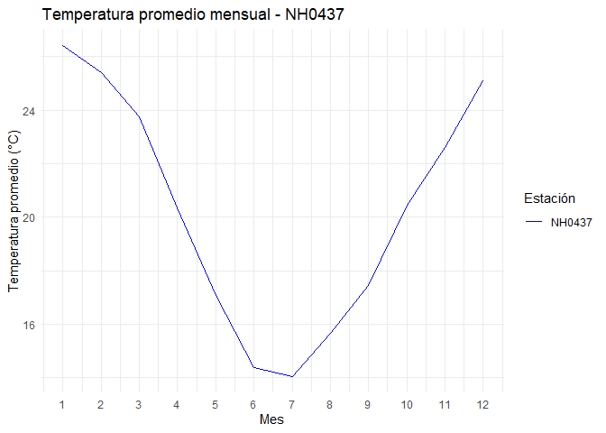

<!-- README.md is generated from README.Rmd. Please edit that file -->

# estacionesINTA

<!-- badges: start -->

[](https://lifecycle.r-lib.org/articles/stages.html#experimental)
<!-- badges: end -->

estacionesINTA es un paquete de R para descargar, leer, resumir y
graficar datos de estaciones meteorológicas del INTA. Fue desarrollado
como ejercicio práctico de la materia Programación II, para aprender a
construir paquetes de R y trabajar de forma colaborativa con Git y
GitHub.

## Advertencia

**Este paquete es únicamente de prueba y tiene fines educativos.**

No está pensado para su utilización real ni para su distribución como
herramienta de análisis meteorológico.

## Funciones

El paquete incluye:

- `leer_estacion()`: descarga y lee los datos de una estación
  meteorológica.
- `tabla_resumen_temperatura()`: calcula el promedio y el desvío
  estándar de la temperatura por estación.
- `grafico_temperatura_mensual()`: grafica la temperatura promedio
  mensual de una o más estaciones.

Además trae el set de datos `estacion_nh0437`, con los registros diarios
de la estación NH0437 entre 1970 y 2023.

## Instalación

Podés instalar la versión en desarrollo de estacionesINTA desde
[GitHub](https://github.com/) con:

``` r
# install.packages("pak")
pak::pak("MicaelaGermi04/estacionesINTA")
```

## Ejemplo de uso

Para descargar y leer los datos de una estación, indicá su código y la
ruta donde guardar el archivo:

``` r
library(estacionesINTA)

estacion <- leer_estacion("NH0437", "NH0437.csv")
```

El paquete incluye los datos de la estación NH0437, así que podés probar
las funciones sin descargar nada. Por ejemplo, para obtener el promedio
y el desvío estándar de la temperatura:

``` r
library(estacionesINTA)

tabla_resumen_temperatura(estacion_nh0437)
#> # A tibble: 2 × 3
#>   id     estadistico          valor
#>   <chr>  <chr>                <dbl>
#> 1 NH0437 promedio_temperatura 20.2 
#> 2 NH0437 desvio_estandar       5.77
```

Y para graficar la temperatura promedio de cada mes:

``` r
grafico_temperatura_mensual(estacion_nh0437,
                            colores = "blue",
                            titulo = "Temperatura promedio mensual - NH0437")
```



## Autoras

- Micaela Germi
- Eugenia Cuenca
