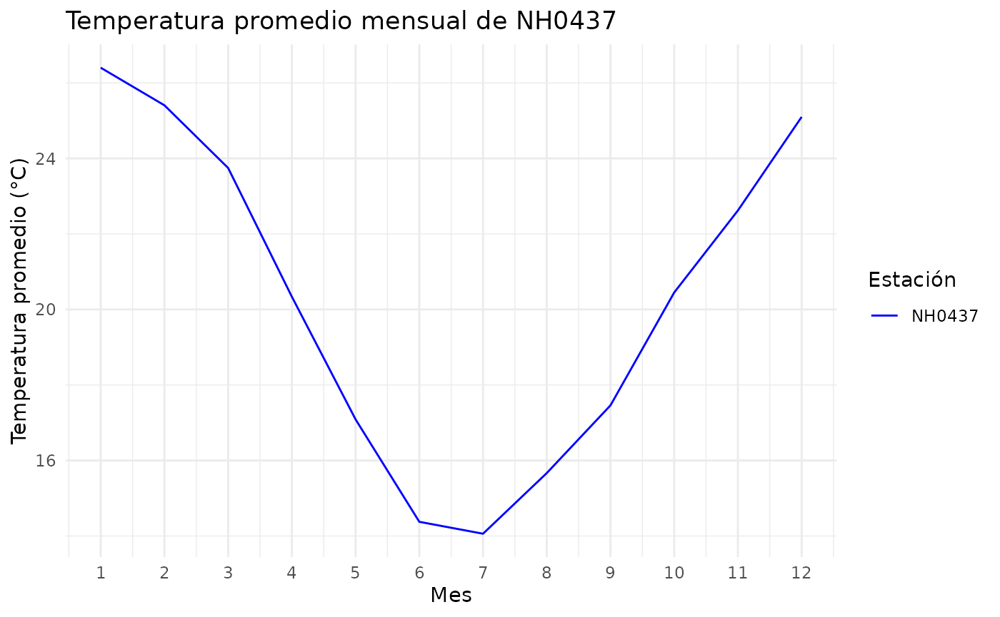

# estacionesINTA

``` r

library(estacionesINTA)
```

## Introducción

El paquete estacionesINTA permite leer datos meteorológicos, resumir
temperaturas por estación y graficar sus promedios mensuales.

En esta viñeta usamos los datos de la estación NH0437 incluidos en el
paquete.

## Explorar los datos

El conjunto estacion_nh0437 contiene registros entre el 1 de agosto de
1970 y el 27 de abril de 2023.

``` r

head(estacion_nh0437)
#>       id      fecha temperatura_abrigo_150cm temperatura_abrigo_150cm_maxima
#> 1 NH0437 1970-08-01                    23.30                            31.2
#> 2 NH0437 1970-08-02                    26.55                            32.1
#> 3 NH0437 1970-08-03                    17.35                            22.9
#> 4 NH0437 1970-08-04                    11.05                            11.9
#> 5 NH0437 1970-08-05                    11.10                            12.6
#> 6 NH0437 1970-08-06                    13.55                            15.1
#>   temperatura_abrigo_150cm_minima temperatura_intemperie_5cm_minima
#> 1                            15.4                              14.2
#> 2                            21.0                              18.8
#> 3                            11.8                              14.1
#> 4                            10.2                              10.8
#> 5                             9.6                               9.7
#> 6                            12.0                              12.6
#>   temperatura_intemperie_50cm_minima temperatura_suelo_5cm_media
#> 1                                 NA                          NA
#> 2                                 NA                          NA
#> 3                                 NA                          NA
#> 4                                 NA                          NA
#> 5                                 NA                          NA
#> 6                                 NA                          NA
#>   temperatura_suelo_10cm_media temperatura_inte_5cm
#> 1                           NA                   NA
#> 2                           NA                   NA
#> 3                           NA                   NA
#> 4                           NA                   NA
#> 5                           NA                   NA
#> 6                           NA                   NA
#>   temperatura_intemperie_150cm_minima humedad_suelo precipitacion_pluviometrica
#> 1                                  NA            NA                         0.0
#> 2                                  NA            NA                         0.0
#> 3                                  NA            NA                        31.0
#> 4                                  NA            NA                        39.5
#> 5                                  NA            NA                         0.0
#> 6                                  NA            NA                         3.4
#>   granizo nieve heliofania_efectiva heliofania_relativa tesion_vapor_media
#> 1       0     0                 9.3                  87               21.1
#> 2       0     0                 9.3                  87               20.8
#> 3       0     0                 0.0                   0               14.8
#> 4       0     0                 0.0                   0               12.4
#> 5       0     0                 0.2                   2               13.3
#> 6       0     0                 0.0                   0               15.2
#>   humedad_media humedad_media_8_14_20 rocio_medio duracion_follaje_mojado
#> 1            NA                    70        18.4                      NA
#> 2            NA                    66        18.1                      NA
#> 3            NA                    94        12.8                      NA
#> 4            NA                    95        10.1                      NA
#> 5            NA                    97        11.2                      NA
#> 6            NA                    97        13.2                      NA
#>   velocidad_viento_200cm_media direccion_viento_200cm
#> 1                         12.8                     NA
#> 2                          7.2                     NA
#> 3                         14.4                     NA
#> 4                         20.0                     NA
#> 5                          4.8                     NA
#> 6                          8.8                     NA
#>   velocidad_viento_1000cm_media direccion_viento_1000cm velocidad_viento_maxima
#> 1                            16                    <NA>                      NA
#> 2                             9                    <NA>                      NA
#> 3                            18                    <NA>                      NA
#> 4                            25                    <NA>                      NA
#> 5                             6                    <NA>                      NA
#> 6                            11                    <NA>                      NA
#>   presion_media radiacion_global radiacion_neta evaporacion_tanque
#> 1            NA             14.8             NA                 NA
#> 2            NA             14.9             NA                 NA
#> 3            NA              4.1             NA                 NA
#> 4            NA              4.1             NA                 NA
#> 5            NA              4.4             NA                 NA
#> 6            NA              4.2             NA                 NA
#>   evapotranspiracion_potencial profundidad_napa horas_frio unidad_frio
#> 1                          3.1               NA          0          NA
#> 2                          3.4               NA          0          NA
#> 3                          2.0               NA          0          NA
#> 4                          0.9               NA          0          NA
#> 5                          0.6               NA          0          NA
#> 6                          0.7               NA          0          NA
```

## Resumir la temperatura

La función tabla_resumen_temperatura() calcula el promedio y el desvío
estándar de la temperatura para cada estación.

``` r

tabla_resumen_temperatura(estacion_nh0437)
#> # A tibble: 2 × 3
#>   id     estadistico          valor
#>   <chr>  <chr>                <dbl>
#> 1 NH0437 promedio_temperatura 20.2 
#> 2 NH0437 desvio_estandar       5.77
```

## Graficar la temperatura mensual

La función grafico_temperatura_mensual() calcula el promedio de
temperatura para cada mes y estación. Los registros de un mismo mes de
distintos años se resumen juntos.

``` r

grafico_temperatura_mensual(
  estacion_nh0437,
  colores = "blue",
  titulo = "Temperatura promedio mensual de NH0437"
)
```



## Leer otra estación

La función leer_estacion() recibe el código de una estación y la ruta
donde se guardará su archivo. Si ese archivo ya existe, lo lee sin
descargarlo nuevamente.

Por ejemplo:

``` r

otra_estacion <- leer_estacion(
  id_estacion = "NH0437",
  ruta = "NH0437.csv"
)
```
